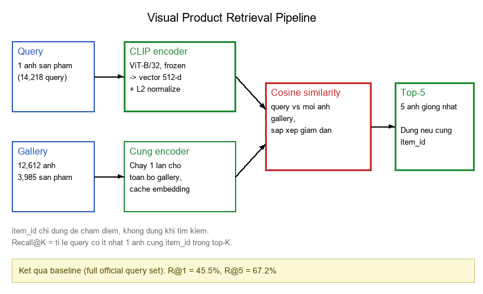

# FCVG101 — Tìm kiếm sản phẩm thời trang bằng hình ảnh

Visual Product Retrieval with Pretrained CLIP · Coursework Computer Vision · Dự án nhóm 2 người

Mới tham gia dự án? Đọc [BẮT ĐẦU TỪ ĐÂY — hướng dẫn cho cả hai thành viên](docs/START_HERE.md) trước. Tài liệu giải thích từng bước bằng ví dụ và bài kiểm tra hiểu bài, không đòi hỏi kiến thức CLIP từ trước. Sau đó đọc [Hiểu dự án qua số liệu thật](docs/HIEU_DU_AN.md): mục đích theo đề, nhãn và các bẫy nhãn, độ tương đồng cosine đo trên dữ liệu thật, và đóng góp của dự án.

Trạng thái: Đã hoàn thành baseline không huấn luyện và một số thí nghiệm xử lý ảnh trên validation. Chưa có kết quả huấn luyện ArcFace hoặc fine-tuning CLIP được ghi nhận trong repository. Repo chưa phải bài coursework hoàn chỉnh.

## 1. Dự án giải quyết vấn đề gì?

Người dùng có một ảnh quần áo và muốn tìm đúng sản phẩm đó trong kho ảnh, kể cả khi ảnh truy vấn và ảnh trong kho được chụp từ những góc khác nhau.

Ví dụ: ảnh truy vấn là chiếc quần jean trên người mẫu chụp toàn thân; trong kho chỉ có ảnh cùng chiếc quần chụp từ phía sau. Hệ thống cần tìm đúng chiếc quần, không chỉ tìm một chiếc quần khác trông giống.

- **Input:** 1 ảnh truy vấn (query image).
- **Search space:** Tập ảnh kho (gallery) và embeddings đã tính trước của chúng.
- **Output:** Top-5 ảnh có sẵn trong gallery, kèm cosine similarity và thứ hạng. Hệ thống không sinh ảnh mới.
- **Đáp án đúng (ground truth):** Ảnh gallery có cùng `item_id` với query. `item_id` không được dùng để tìm kiếm, chỉ dùng để huấn luyện có giám sát hoặc đánh giá sau khi đã có kết quả.

**Tại sao Recall không gần 100% nếu sản phẩm đã ở trong kho?** Vì gallery có ảnh cùng sản phẩm nhưng không trùng file/pixel với query. Góc chụp, độ phóng đại, người mẫu và các sản phẩm rất giống nhau khiến mô hình có thể xếp nhầm sản phẩm khác lên trước. Bài toán là instance-level retrieval, không phải tìm bản sao ảnh.

## 2. Dữ liệu: DeepFashion In-shop

Dataset do Multimedia Lab, The Chinese University of Hong Kong giới thiệu trong DeepFashion (CVPR 2016). Dataset chỉ được phép dùng cho nghiên cứu và giáo dục phi thương mại theo README của nhà phát hành.

| Tập | Số ảnh | Số item_id | Vai trò |
|---|---:|---:|---|
| Official train | 25.882 | 3.997 | Dành cho huấn luyện và tạo validation |
| Official query | 14.218 | 3.985 | Ảnh yêu cầu tìm |
| Official gallery | 12.612 | 3.985 | Kho để tìm ảnh cùng sản phẩm |

Tổng cộng 52.712 ảnh, 7.982 sản phẩm, 23 nhóm quần áo. Product IDs của train tách khỏi evaluation; query/gallery chia sẻ product IDs nhưng không chia sẻ ảnh trùng pixel chính xác theo kiểm tra của pilot.

Các file dữ liệu chính:

```
[Thư mục dữ liệu ngoài repo]/
├── img/                         # Ảnh JPG giải nén từ Img/img.zip
│   ├── MEN/<category>/<item_id>/*.jpg
│   └── WOMEN/<category>/<item_id>/*.jpg
├── Eval/list_eval_partition.txt # image_name, item_id, train/query/gallery
└── list_bbox_inshop.txt         # tọa độ sản phẩm + loại quần áo/pose
```

- `img/`: pixel ảnh thực sự được đưa vào CLIP.
- `Eval/list_eval_partition.txt`: xác định vai trò mỗi ảnh và `item_id` đúng.
- `list_bbox_inshop.txt`: chỉ được dùng trong thí nghiệm crop, không dùng cho baseline full-image.
- Các metadata khác (landmark, attribute, segmentation, dense pose) tồn tại trong bản phát hành, nhưng chưa cần cho baseline.

Xem [hướng dẫn đọc dữ liệu và kiểm tra nhãn](docs/DATASET_AND_PIPELINE.md) trước khi huấn luyện hay trình bày kết quả.

## 3. Pipeline hiện tại hoạt động thế nào?



> **Ảnh minh họa từ dữ liệu** (cùng sản phẩm nhiều góc chụp, sản phẩm khác nhưng giống nhau, so sánh cắt bbox, ví dụ truy hồi thành công/thất bại thật từ `reports/per_query_results.csv`) **không được đưa lên repo**: ảnh DeepFashion chỉ được dùng cho nghiên cứu/giáo dục phi thương mại, còn repo này đang public. Khi đã có `img/` và `list_bbox_inshop.txt` nằm cạnh repo, tạo lại ảnh trên máy bằng lệnh `.venv/Scripts/python.exe scripts/generate_docs_images.py`, ảnh sẽ nằm trong `docs/images/dataset/`.

**Chuẩn bị một lần cho gallery**

Ảnh gallery → preprocessing CLIP → CLIP image encoder → embedding 512 chiều → L2 normalize → lưu cache

**Mỗi lần tìm kiếm**

Ảnh query → preprocessing CLIP → CLIP image encoder → embedding 512 chiều → cosine similarity với toàn bộ gallery embeddings → sort giảm dần → Top-5

**Đánh giá (không tham gia tìm kiếm)**

Top-K image paths → tra `item_id` từ annotation → so với `item_id` của query → Recall@1 / Recall@5

Model baseline là OpenAI CLIP ViT-B/32 pretrained, frozen (không cập nhật trọng số). Chỉ dùng image encoder, không có decoder tạo ảnh; cosine similarity sau L2 normalization tương đương tích vô hướng. Retrieval hiện tại là exact brute-force, không phải vector database hay mô hình reranker.

**Recall@K** trong benchmark này là tỷ lệ query có ít nhất một ảnh cùng `item_id` trong K kết quả đầu. Đây không phải độ chính xác phân loại 23 nhóm quần áo hay xác suất mô hình đúng.

## 4. Kết quả đã đo — tách rõ test và validation

### Official query/gallery — baseline (không training)

| Cấu hình | Query | Gallery | R@1 | R@5 |
|---|---:|---:|---:|---:|
| Frozen CLIP ViT-B/32, full image, cosine | 14.218 | 12.612 | 45,51% (6.470 query) | 67,25% (9.561 query) |

Nguồn: [`reports/metrics.json`](reports/metrics.json), [`reports/BAO_CAO_PILOT.md`](reports/BAO_CAO_PILOT.md), [`reports/independent_verification.json`](reports/independent_verification.json). Không sử dụng tập train để cập nhật model trong baseline này.

### Validation tạo từ official train — thí nghiệm xử lý ảnh (không training)

Nhóm tách 400 item_id từ official train để tạo 1.232 val query và 1.384 val gallery; các IDs này không nằm trong phần train còn lại (23.266 ảnh). Đây là tập chọn cấu hình, không phải official test.

| Cấu hình trên cùng validation | R@1 | R@5 |
|---|---:|---:|
| Full-image frozen CLIP | 71,10% | 87,26% |
| Bbox crop + padding màu mean | 53,57% | 69,48% |
| Bbox crop + padding trắng | 65,75% | 84,09% |
| HSV histogram trên ảnh crop/pad | 33,36% | 48,78% |

Nguồn: [`reports/val_results.json`](reports/val_results.json), [`reports/val_crop_ablation.json`](reports/val_crop_ablation.json).

**Không được so trực tiếp 71,10% validation với 45,51% official test:** gallery validation nhỏ hơn gần 9 lần và có ít product IDs hơn. Crop với frozen CLIP chưa vượt full-image trên validation; màu padding ảnh hưởng đáng kể, nhưng chưa chứng minh nguyên nhân cơ chế. HSV baseline hiện bị ảnh hưởng bởi pixel padding, nên chưa phải đối chứng handcrafted hoàn toàn công bằng.

## 5. Câu hỏi nghiên cứu và công việc tiếp theo

**Câu hỏi:** Khi một pretrained encoder chưa tối ưu cho việc phân biệt từng sản phẩm thời trang, các phương pháp xử lý ảnh và adaptation nhẹ có giúp cải thiện Retrieval Recall@K trên những product IDs chưa thấy trong training không?

**Đã có bằng chứng:** Baseline frozen, crop/padding ablations, phân tích lỗi ban đầu, audit nhãn và split.

**Chưa có bằng chứng cải thiện từ training:** Linear projection head, ArcFace và partial fine-tuning mới là phương án đề xuất, chưa phải kết quả đã chạy trong repo hiện tại.

**Hướng triển khai dự kiến:** (1) hiểu dataset và lỗi thật; (2) chốt validation/protocol; (3) so sánh frozen CLIP vs linear head vs ArcFace trên cùng validation; (4) cân nhắc partial fine-tuning nếu đủ thời gian/compute; (5) đánh giá cuối trên official query/gallery. Tránh điều chỉnh liên tục theo official test đã quan sát.

**Giới hạn:** benchmark dùng ảnh in-shop/studio; kết quả không tự động áp dụng cho ảnh điện thoại hoặc ảnh người dùng chụp ngoài đời. Công việc Task 3 OpenCV theo đề coursework cần được bổ sung riêng.

## 6. Bắt đầu đọc/chạy dự án

Nếu lần đầu mở repo, xem theo thứ tự:

1. [`docs/START_HERE.md`](docs/START_HERE.md) — Bắt đầu từ con số 0: bài toán, ảnh thật cần xem, cách đọc nhãn, cách tự chấm một query, các câu hỏi tự kiểm tra.
2. [`docs/DATASET_AND_PIPELINE.md`](docs/DATASET_AND_PIPELINE.md) — ảnh, nhãn, query/gallery và ví dụ đúng/sai.
3. [`notebooks/learn_clip_retrieval.ipynb`](notebooks/learn_clip_retrieval.ipynb) — notebook học bằng tiếng Việt (cần data + cache local).
4. [`reports/BAO_CAO_PILOT.md`](reports/BAO_CAO_PILOT.md) — kết quả thí nghiệm thực tế.
5. [`notebooks/task1_data_pipeline.ipynb`](notebooks/task1_data_pipeline.ipynb) — tiền xử lý, crop, handcrafted HSV.
6. [`vps/`](vps/) — các module đọc annotation, embedding, retrieval, metrics.

Repo không chứa ảnh DeepFashion, weights hoặc cache embeddings do dung lượng và điều kiện dữ liệu. Nếu chỉ clone repo mới thì chưa chạy ngay được notebook phụ thuộc dữ liệu. Trên workspace Windows ban đầu, project nằm cùng cấp với `img/`, `Eval/` và `list_bbox_inshop.txt` (chi tiết ở mục sau).

Để chạy test mã nguồn từ thư mục repo đã cài dependencies:

```bash
python -m pytest -q
```

Nếu đã có `.venv` và data theo layout cũ, có thể xem các lệnh audit/encode/evaluate trong [`scripts/pilot.py`](scripts/pilot.py). Chạy baseline đầy đủ trên Kaggle cần dataset riêng tư và GPU; tham khảo [`notebooks/deepfashion_clip_baseline.ipynb`](notebooks/deepfashion_clip_baseline.ipynb). Không nhầm unit tests thành số liệu retrieval thực nghiệm.

## 7. Cấu trúc repo và phối hợp nhóm

```
notebooks/    # Hướng dẫn trực quan và thí nghiệm
vps/          # Code dùng lại: annotations, preprocess, embeddings, metrics
scripts/      # CLI chạy/kiểm tra/tạo notebook
reports/      # Metrics, logs, báo cáo và phân tích
tests/       # Kiểm thử code
docs/         # START_HERE và giải thích dữ liệu
```

Dự án có 2 thành viên; phân chia việc chính thức do nhóm thống nhất, không mặc định một người là tác giả toàn bộ code hay thí nghiệm. Mỗi thí nghiệm nên ghi người thực hiện, commit, tập dữ liệu, cấu hình, seed, kết quả và cách tái lập. Xem [`CONTRIBUTING.md`](CONTRIBUTING.md) để phối hợp qua branch và pull request.

## 8. Tài liệu tham khảo

- [DeepFashion / In-shop benchmark (CUHK)](https://mmlab.ie.cuhk.edu.hk/projects/DeepFashion/InShopRetrieval.html)
- [DeepFashion, CVPR 2016](https://openaccess.thecvf.com/content_cvpr_2016/papers/Liu_DeepFashion_Powering_Robust_Properties_CVPR_2016_paper.pdf)
- [OpenAI CLIP](https://openai.com/research/clip)
- UniCom paper (đối chiếu baseline, cần kiểm tra khác biệt giao thức)
