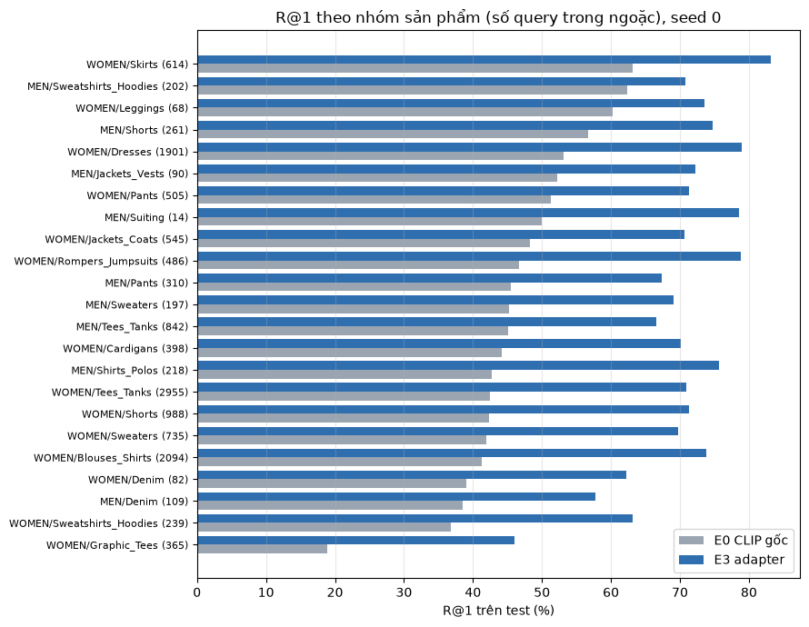
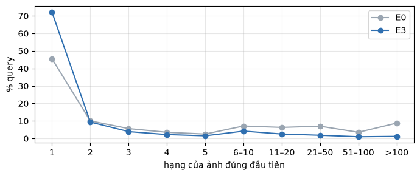

# Báo cáo FCVG101 — Tìm sản phẩm thời trang bằng ảnh (bản nháp)

> Nháp 2026-11-19, theo đúng thứ tự yêu cầu của đề. Ô **[Phong]** là phần Phong viết; ô **[TODO]** là việc còn thiếu.
> Mọi số liệu lấy từ file trong `reports/` (đã chạy thật); mỗi bảng ghi nguồn. Khi xuất PDF: thay ảnh demo trong
> `artifacts/task2/` (ảnh DeepFashion, không đưa lên repo public) vào chỗ đánh dấu.

**Nhóm:** Trung (Task 2: mô hình, thực nghiệm, demo) · Phong (Task 3, phân tích lỗi, kiểm tra Task 1)
**Hướng đề tài:** E — Foundation Models for Vision (multimodal retrieval, *efficient adaptation*) và D — Visual Representation Learning (image embeddings, Recall@K).

---

## 1. Bài toán, dữ liệu và lý do chọn

**Bài toán.** Cho một ảnh sản phẩm (query), tìm ảnh của **đúng món đó** trong kho ảnh của shop (gallery). Đây là image-to-image retrieval: đầu ra là danh sách xếp hạng, không phải nhãn lớp.

**Dataset.** DeepFashion In-shop Clothes Retrieval (Liu et al., CVPR 2016): 52.712 ảnh, 7.982 món (`item_id`), 23 nhóm sản phẩm (giới tính × loại đồ). Nhãn gồm `list_eval_partition.txt` (ảnh, item_id, split) và `list_bbox_inshop.txt` (loại đồ, kiểu chụp, bbox trên ảnh 256×256).

| Split chính thức | Ảnh | Món |
|---|---|---|
| train | 25.882 | 3.997 |
| test — query | 14.218 | 3.985 |
| test — gallery | 12.612 | 3.985 |

**Lý do chọn.**
- Bài toán có thật (tìm sản phẩm bằng ảnh trong thương mại điện tử) và có benchmark công khai để so sánh.
- Món ở test **không xuất hiện ở train** → mô hình phải học *cách biểu diễn ảnh*, không học thuộc nhãn. Đây đúng nội dung LO3 (representation learning).
- Vừa sức máy cá nhân (RTX 3050 Ti 4 GB): dùng encoder có sẵn rồi thích nghi, không cần train mô hình lớn.

**Vấn đề chất lượng dữ liệu** (chi tiết, hình: `notebooks/task1_data_pipeline.ipynb`, ô 3–4):
- Nhóm sản phẩm rất mất cân bằng (WOMEN/Tees_Tanks 2.955 query, MEN/Suiting 14 query); mỗi món chỉ có vài ảnh.
- Query thường chụp cận cảnh, gallery thường toàn thân → lệch phân bố hai phía.
- Một phần bbox ở ảnh chụp nghiêng chỉ là một dải hẹp, không bao trọn món đồ (6,3% query val có bbox hẹp).
- Nhiều món khác nhau gần như trùng màu và kiểu dáng → giới hạn tự nhiên của retrieval chỉ dựa vào ảnh.

## 2. Chiến lược chia dữ liệu và chống rò rỉ

| Tập | Lấy từ | Dùng để |
|---|---|---|
| adapter-train: 23.266 ảnh / 3.597 món | 90% món của split train | học adapter |
| validation: 1.232 query / 1.384 gallery / 400 món | 10% **món** còn lại của split train, chia query/gallery theo đúng kiểu test | chọn cấu hình, epoch, ratio |
| test: 14.218 query / 12.612 gallery / 3.985 món | split chính thức | **chạy đúng một lần** ở cuối |

- Chia validation **theo món**, không theo ảnh, để val cũng là "món chưa thấy" như test (`vps.preprocess.validation_split`, seed `fcvg101-val`).
- Kiểm tra tự động: món train ∩ món val = ∅, món train ∩ món test = ∅, không ảnh nào vừa ở query vừa ở gallery (`vps.annotations.validate_splits`, `assert` trong `scripts/train_adapter.py`).
- Gallery test dùng **đủ 12.612 ảnh** làm nhiễu, không lấy mẫu con.
- Không tham số nào được chọn trên test. Năm cấu hình test được chốt trên val trước (ghi trong `docs/T1_ADAPTER_GIAI_THICH.md`, mục 5c, commit trước commit chạy test).

## 3. Pipeline xử lý dữ liệu (Task 1)

```text
ảnh JPEG ─► RGB ─► [crop theo bbox, lề 10%, cạnh ≥ 64 px] ─► [pad vuông] ─► resize 224 + center crop ─► normalize (mean/std CLIP) ─► batch
                    └── chỉ ở cấu hình crop ──────────────┘   [augmentation: chỉ khi train]
```

| Bước | Mục đích | Cài đặt |
|---|---|---|
| Đọc + chuyển RGB | đảm bảo 3 kênh | PIL, `vps/preprocess.py` |
| Crop bbox (+10%, cạnh ≥ 64 px, dịch vào trong ảnh) | tập trung vào món đồ, bỏ bớt người mẫu/nền | `BBoxCropPad` |
| Pad về hình vuông | để center crop 224 của CLIP không cắt mất mép sản phẩm | `pad_to_square` (màu trung bình hoặc trắng) |
| Resize, center crop, normalize | đúng đầu vào CLIP đã được train | preprocess gốc của `openai/CLIP` |
| Batch | `DataLoader`, 64 ảnh/batch, 6 worker | `vps/embed.py` |

**Augmentation (chỉ train):** RandomResizedCrop 75–100%, lật ngang, độ sáng/tương phản ±20%, RandomErasing p = 0,25. **Không** đổi hue/saturation vì màu là đặc điểm nhận dạng món. Hình minh hoạ: notebook Task 1, ô 8.

**Biểu diễn ảnh đã so sánh (trên val, CLIP đóng băng)** — nguồn: `reports/val_results.json`, `reports/val_crop_ablation.json`.

| Cấu hình Task 1 | Biểu diễn | R@1 val | R@5 val |
|---|---|---|---|
| C0 ảnh đầy đủ (baseline) | CLIP 512-d | 71,10 | 87,26 |
| C1 crop + pad màu trung bình | CLIP 512-d | 53,57 | 69,48 |
| A1 crop + pad **trắng** | CLIP 512-d | 65,75 | 84,09 |
| C3 crop + HSV histogram | thủ công, 128-d | 33,36 | 48,78 |
| Đối chứng: che món, giữ nền | CLIP 512-d | 22,73 | 38,31 |

Nhận xét: biểu diễn sâu hơn hẳn histogram màu (hơn 38 điểm). Crop **làm CLIP đóng băng kém đi**, nhưng pad trắng giảm thiệt hại phần lớn (53,6 → 65,8). Đối chứng "che món" vẫn đạt 22,7%, cho thấy CLIP dựa một phần vào bối cảnh (người mẫu, nền). Ba cấu hình đưa sang Task 2: **ảnh đầy đủ**, **ảnh đầy đủ + augmentation**, **crop + pad trắng**.

**[Phong]** Đối chiếu từng ý của Task 1 trong đề với notebook (P6): mô tả dataset, pipeline, hình augmentation, ≥ 2 cấu hình — ghi phần còn thiếu.

## 4. Mô hình và cách huấn luyện (Task 2)

```text
ảnh ─► CLIP ViT-B/32 (đóng băng, 88 triệu tham số) ─► f (512-d, chuẩn hoá L2)
     ─► adapter: Linear 512→128 ─► ReLU ─► Linear 128→512 ─► ReLU  = A(f)
     ─► z = 0,2·A(f) + 0,8·f ─► chuẩn hoá L2 ─► cosine với 12.612 vector gallery ─► Top-K
khi train: z ─► ArcFace (s = 30, m = 0,3) trên 3.597 món train;   lớp ArcFace bỏ đi sau khi train
```

**Vì sao chọn như vậy.**
- **CLIP đóng băng:** encoder có sẵn, mạnh, đã kiểm chứng; tái lập đúng con số của tài liệu (45,5% so với 45,4% trong Unicom, Bảng 2). Máy 4 GB không đủ để fine-tune toàn bộ ViT một cách thoải mái.
- **Adapter có residual (CLIP-Adapter, Gao et al. 2021):** chỉ 131.072 tham số. Nút cổ chai 128 chiều hạn chế học thuộc. Phần residual 0,8·f giữ lại kiến thức gốc: `ratio = 0` cho ra đúng CLIP gốc (có unit test). Cấu trúc lấy theo code của tác giả (hai ReLU, không bias).
- **ArcFace (Deng et al. 2019):** món test chưa từng thấy nên không thể phân loại. Nhưng khi train, coi mỗi món là một lớp để học "cùng món thì gần, khác món thì xa", có thêm lề góc. Hạng 5 cuộc thi Google Universal Image Embedding 2022 cũng dùng CLIP đóng băng + head + ArcFace.
- **Lưu sẵn vector CLIP:** encoder đóng băng nên mỗi ảnh chỉ cần mã hoá một lần; train adapter chỉ mất vài giây mỗi epoch. Hệ quả: muốn augmentation có tác dụng thì phải lưu thêm vector của các bản augmented (E2: 3 bản/ảnh).

**Thiết lập** (`scripts/train_adapter.py`, `vps/adapter.py`):

| Mục | Giá trị |
|---|---|
| Framework | PyTorch 2.14.1 (CUDA 13.0), Python 3.12, gói `openai/CLIP` (commit d05afc4) |
| Backbone | OpenAI CLIP ViT-B/32, checkpoint chính thức, SHA-256 `40d36571…950af`, fp16, đóng băng |
| Adapter | 512→128→512, ReLU, không bias; residual ratio 0,2 (đã thử 0,5 trên val: gần hoà) |
| Loss | ArcFace, s = 30, m = 0,3, 3.597 lớp |
| Optimizer | AdamW, lr 1e-3 (adapter), 1e-2 (lớp ArcFace), weight decay 1e-4, lr không đổi |
| Batch / epoch | 256 / 40 |
| Chọn checkpoint | epoch có R@1 val cao nhất |
| Seed | 0, 1, 2 (báo cáo trung bình và min–max) |
| Phần cứng | RTX 3050 Ti Laptop 4 GB; train 40 epoch mất 45 s (E3 seed 0); mã hoá 25.882 ảnh: lần đầu 6.305 s (đọc ổ đĩa lạnh), các lần sau 96 s |

## 5. Thực nghiệm và kết quả

**Các cấu hình (đổi một yếu tố mỗi lần):** E0 CLIP đóng băng (baseline) → E1 thêm adapter → E2 = E1 + ảnh augmented → E3 = E1 nhưng ảnh crop + pad trắng.

**Validation** (3 seed, 40 epoch; nguồn: `reports/adapter_*_val_*_ep40.json`):

| Cấu hình | R@1 val TB [min–max] | R@5 val |
|---|---|---|
| E0 CLIP đóng băng | 71,02 | 87,34 |
| E1 adapter | 90,94 [90,50–91,31] | 97,24 |
| E2 adapter + augmented | 90,99 [90,42–91,31] | 96,97 |
| E3 adapter, crop + pad trắng | 91,69 [91,40–92,05] | 98,00 |

**Test, chạy một lần** (nguồn: `reports/test_results.json`, `scripts/eval_test.py`; 14.218 query, đủ 12.612 ảnh gallery):

| Cấu hình | R@1 TB [min–max 3 seed] | R@5 | R@10 | MRR |
|---|---|---|---|---|
| E0 CLIP đóng băng, ảnh đầy đủ | 45,51 | 67,25 | 74,36 | 55,51 |
| E0 CLIP đóng băng, crop + pad trắng | 39,58 | 60,85 | 68,54 | 49,41 |
| E1 + adapter | 71,42 [71,25–71,56] | 88,93 | 92,72 | 79,16 |
| E2 + adapter + augmented | 71,06 [70,24–71,77] | 88,59 | 92,54 | 78,83 |
| **E3 + adapter, crop + pad trắng** | **72,20 [72,04–72,51]** | **89,29** | **93,25** | **79,81** |



**So với tài liệu** (cùng benchmark; nguồn: `reports/NGHIEN_CUU_HUONG_DI.md`): CLIP B/32 đóng băng 45,4%; Unicom B/32 đóng băng 72,8%; các phương pháp fine-tune toàn bộ 86–95%.

## 6. Demo suy luận

`notebooks/task2_demo.ipynb` (ô 3–4), lõi ở `vps/search.py`. Mô hình nhận một ảnh, mã hoá bằng CLIP + adapter, so với 12.612 ảnh gallery, rồi trả về Top-5 kèm cosine; E0 và E3 hiển thị cạnh nhau. Ảnh dùng để demo là query test, thuộc món chưa từng có ở train (notebook `assert` điều này). Ô 4 nhận **bất kỳ ảnh nào** qua `MY_IMAGE`; ảnh ngoài dataset không có bbox nên chỉ được pad trắng, không crop. Kiểm tra: mã hoá lại từ file cho ra vector trùng cache (cosine 1,0000) và cùng hạng như lúc đánh giá.

**[TODO khi xuất PDF]** Chèn `artifacts/task2/demo_example_dress.png`. Trong ví dụ này E0 xếp 5 chiếc váy trắng khác lên đầu, còn E3 đưa đúng món lên #1 và #2.

## 7. Phân tích lỗi

Nguồn: `notebooks/task2_demo.ipynb` ô 5–6, seed 0, toàn bộ 14.218 query.

| E0 \ E3 | E3 đúng ở #1 | E3 sai |
|---|---|---|
| E0 đúng | 5.672 | 798 (adapter làm hỏng) |
| E0 sai | 4.573 (adapter sửa được) | 3.175 |



- Adapter sửa được gần 6 query cho mỗi query nó làm hỏng (4.573 so với 798). Mức tăng không phải "miễn phí": vẫn có 798 query trước đúng nay sai.
- Khi E3 sai ở #1, món đúng vẫn nằm trong #2–5 ở 61% trường hợp. Nghĩa là phần lớn lỗi là xếp hạng sát nút giữa các món rất giống nhau, không phải tìm lạc hẳn.
- Nhóm khó nhất là WOMEN/Graphic_Tees (18,9 → 46,0%). Giả thuyết: hình in nhỏ khó nhìn ở độ phân giải 224×224, mà màu và dáng áo thì gần như giống hệt nhau.

**[Phong]** Bảng nhóm lỗi (P3/P5): xem 6 lỗi ngẫu nhiên ở ô 6 cùng các ví dụ khác, rồi xếp vào các nhóm: gần trùng màu/dáng, cận cảnh so với toàn thân, hình in nhỏ, bbox nghiêng hẹp… Ghi số query và một ảnh ví dụ cho mỗi nhóm.

## 8. Task 3 — Thực nghiệm nhỏ về hình học và chuyển động  **[Phong]**

- **3A:** hiệu chỉnh camera bằng ảnh bàn cờ; lọc tuyến tính, FFT, gradient Sobel, điểm đặc trưng (Harris/ORB/SIFT). Mỗi kỹ thuật một hình kèm 2–3 câu giải thích.
- **3B:** optical flow Farneback giữa hai khung hình video tự quay, vẽ bằng mũi tên hoặc màu, kèm nhận xét.

## 9. Thảo luận và giới hạn (tư duy ngược)

- **Điều gì tốt hơn dự kiến:** adapter tăng 26 điểm R@1 trên test với 131 nghìn tham số, đưa CLIP B/32 lên ngang Unicom đóng băng. Vì kết quả tốt bất ngờ nên nhóm kiểm tra lỗi trước khi tin: không trùng món giữa train/val/test, E0 tái lập đúng 45,51%, hạng tính lại từ file ảnh khớp với cache.
- **Điều gì không như kỳ vọng:**
  - **Augmentation (E2) không giúp.** CLIP đóng băng gần như không đổi vector giữa các bản augmented (cosine giữa hai bản ≈ 0,93), nên adapter không có thêm thông tin để học. Augmentation có ích khi chính encoder được học.
  - **Crop có tác động đảo chiều.** Crop làm CLIP gốc kém đi 6 điểm trên test, nhưng khi có adapter lại nhỉnh nhất (+0,8 điểm). Mức chênh nhỏ, chỉ nên coi là "nhỉnh hơn và ổn định qua 3 seed", không phải "tốt hơn rõ rệt".
- **Giới hạn:**
  - Vẫn kém fine-tune 15–20 điểm. Adapter chỉ sắp xếp lại thông tin CLIP đã nhìn thấy, không thể "nhìn" chi tiết mới như hình in nhỏ.
  - Val dễ hơn test nhiều: 90% trên val chỉ còn 71% trên test.
  - Chỉ dùng ảnh, không dùng mô tả văn bản.
  - Cấu hình crop cần bbox; với ảnh ngoài dataset phải có thêm bộ phát hiện đối tượng.
- **Đóng góp của nhóm (khác với phần tái sử dụng):**
  - **Tái sử dụng:** CLIP, cấu trúc CLIP-Adapter, ArcFace.
  - **Nhóm tự làm:** pipeline dữ liệu và chia val theo món; nghiên cứu crop/pad/augmentation/biểu diễn ảnh ở Task 1 và nối nó vào Task 2; vòng train/chọn trên val; đánh giá test một lần; demo; phân tích lỗi. **Không** phải phương pháp mới.
- **Hướng tiếp theo** (đề xuất, chưa đo): fine-tune vài block cuối của CLIP; backbone mạnh hơn (CLIP B/16, Unicom); xếp hạng lại (re-ranking) top-10.

## 10. Hướng dẫn chạy

Xem `MODEL_LINKS.md` (link checkpoint, CLIP, dataset; thứ tự lệnh). Tóm tắt:

```text
pip install -r requirements.txt            # cần dataset ở thư mục cha của repo
python -m pytest -q                        # 37 test, không cần dataset
python scripts/eval_test.py                # tái lập bảng test (cần cache embedding + checkpoint)
notebooks/task2_demo.ipynb                 # demo + phân tích lỗi (chạy được trên CPU)
```
Checkpoint: hai adapter dùng cho demo có sẵn trong ZIP; đủ 9 checkpoint ở Google Drive (link trong `MODEL_LINKS.md`).

## 11. Tài liệu tham khảo  **[TODO: thống nhất một kiểu trích dẫn, ví dụ IEEE]**

1. Z. Liu, P. Luo, S. Qiu, X. Wang, X. Tang. *DeepFashion: Powering Robust Clothes Recognition and Retrieval with Rich Annotations.* CVPR 2016.
2. A. Radford et al. *Learning Transferable Visual Models From Natural Language Supervision.* ICML 2021 (CLIP).
3. P. Gao et al. *CLIP-Adapter: Better Vision-Language Models with Feature Adapters.* arXiv:2110.04544, 2021.
4. J. Deng, J. Guo, N. Xue, S. Zafeiriou. *ArcFace: Additive Angular Margin Loss for Deep Face Recognition.* CVPR 2019.
5. X. An et al. *Unicom: Universal and Compact Representation Learning for Image Retrieval.* ICLR 2023 (arXiv:2304.05884).
6. GUIE 2022, lời giải hạng 5: arXiv:2210.09495.
7. N.-A. Ypsilantis et al. *Towards Universal Image Embeddings (UnED).* ICCV 2023 (arXiv:2309.01858).
