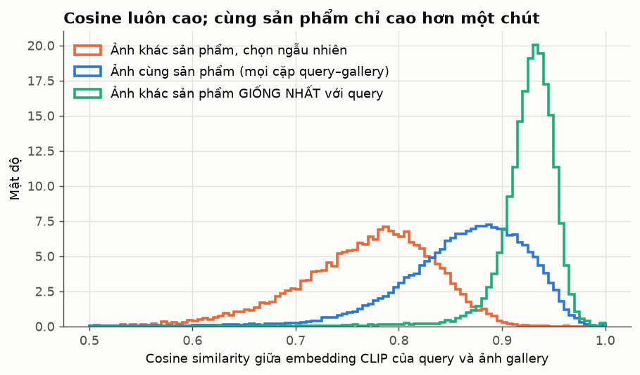
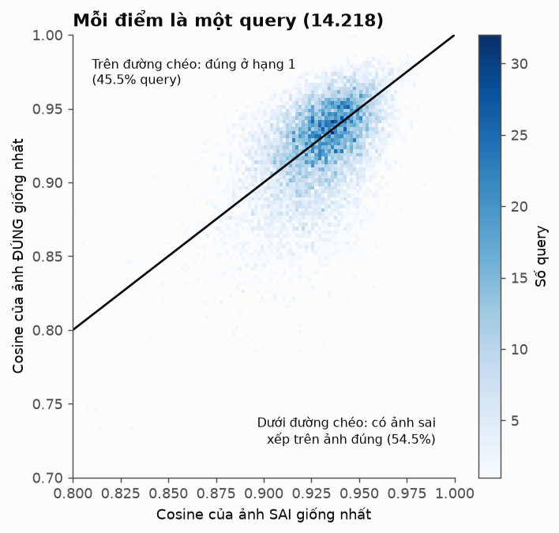
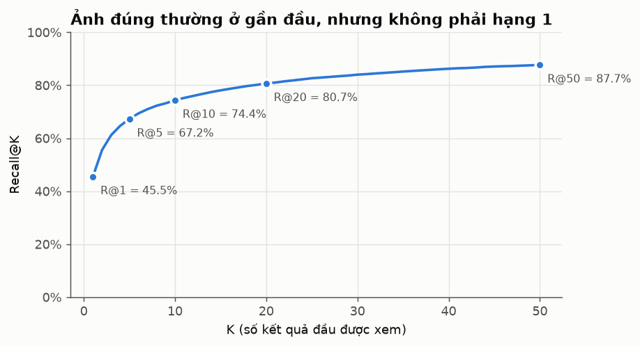
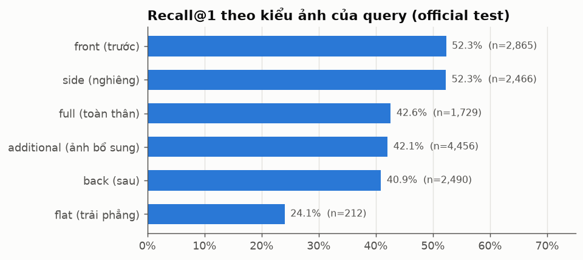
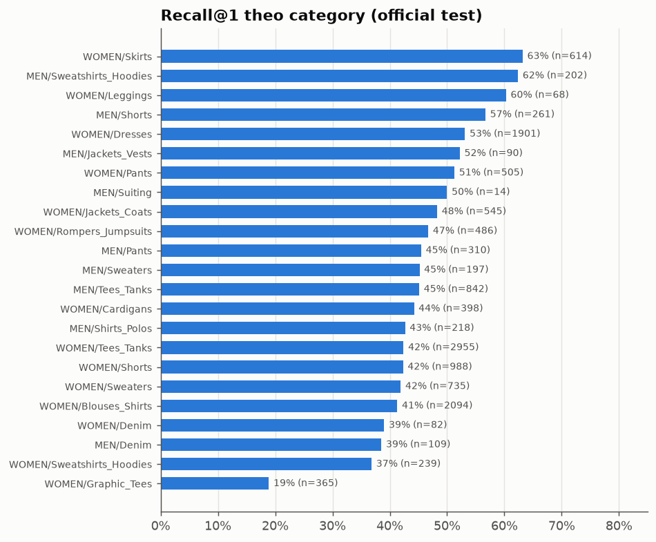
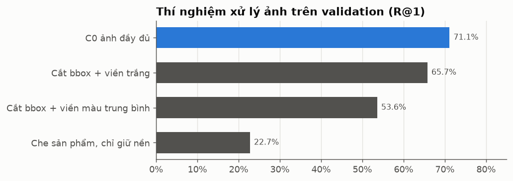

# Hiểu dự án qua số liệu thật: mục đích, dữ liệu, nhãn, độ tương đồng và đóng góp

Tài liệu này dành cho thành viên mới. Đọc sau [START_HERE.md](START_HERE.md) hoặc đọc trước cũng được. Mọi con số và biểu đồ ở đây được tính từ dữ liệu và kết quả thật của dự án bằng [`scripts/make_onboarding_figures.py`](../scripts/make_onboarding_figures.py). Số liệu đầy đủ ở [`reports/onboarding_stats.json`](../reports/onboarding_stats.json). Biểu đồ chỉ chứa số tổng hợp, không chứa ảnh DeepFashion.

## Đọc trong 5 phút

- **Bài toán:** cho 1 ảnh quần áo, tìm trong kho 12.612 ảnh những ảnh **của đúng sản phẩm đó** (cùng `item_id`), không phải sản phẩm na ná.
- **Cách làm hiện tại:** CLIP ViT-B/32 có sẵn, không huấn luyện, biến mỗi ảnh thành 1 vector 512 số. So hai ảnh bằng cosine similarity, xếp hạng và lấy Top-5.
- **Kết quả:** ảnh đứng đầu đúng sản phẩm ở **45,5%** query (R@1); có ít nhất 1 ảnh đúng trong Top-5 ở **67,2%** query (R@5).
- **Vì sao chưa cao:** với CLIP gốc, ảnh cùng sản phẩm chỉ giống nhau hơn ảnh khác sản phẩm một chút. Trong 12.600 ảnh sai, thường có 1 ảnh còn giống query hơn ảnh đúng (mục 3).
- **Hướng đóng góp:** dạy cho embedding phân biệt *từng sản phẩm* (Task 2), đo cải thiện công bằng trên cùng giao thức, và giải thích được mô hình sai ở đâu.

---

## 1. Mục đích: dự án này làm để làm gì?

### 1.1 Theo đề bài môn học

Đề FCVG101 (`QDH_Coursework_FCVG101_.docx`) yêu cầu **một dự án ML/DL hoàn chỉnh** cho một bài toán thị giác thực tế, cộng hai thí nghiệm nhỏ độc lập:

| Phần đề | Điểm | Dự án này đáp ứng bằng gì | Trạng thái trong repo |
|---|---:|---|---|
| Task 1: dữ liệu, tiền xử lý, biểu diễn ảnh | 30 | Pipeline đọc nhãn/bbox, chia validation không rò rỉ, cấu hình C0 ảnh đầy đủ / C1 cắt bbox / C2 augmentation / C3 HSV histogram | Đã có code và kết quả validation |
| Task 2: mô hình, đánh giá, inference | 50 | Baseline CLIP frozen + ít nhất 2 cấu hình có kiểm soát, Recall@K trên test, phân tích lỗi, demo truy vấn | Baseline đã đo; **chưa có mô hình được huấn luyện** |
| Task 3A: hiệu chỉnh camera + lọc/gradient/điểm đặc trưng | 10 | Thí nghiệm riêng, có thể dùng dữ liệu khác | **Chưa thấy trong repo** |
| Task 3B: optical flow hoặc stereo depth | 10 | Thí nghiệm riêng | **Chưa thấy trong repo** |

Dự án chọn nhóm đề **D (Visual Representation Learning)** / **E (Foundation Models)**: dùng CLIP làm foundation model và đánh giá bằng Recall@K. Đây là metric chính đề bài gợi ý cho bài toán biểu diễn ảnh.

Đây là môn khám phá, không tính trọng số nặng. Vì vậy mục tiêu thực của nhóm là **hiểu sâu và làm đúng phương pháp**, không phải chạy theo con số.

### 1.2 Bài toán ngoài đời

Đây là bài toán "tìm sản phẩm bằng ảnh" (visual product search), như Google Lens, Taobao Pailitao hay Pinterest Shop the Look. Khó ở chỗ cần nhận ra **cùng một món hàng** qua góc chụp, tư thế, độ phóng to khác nhau, trong khi kho có hàng nghìn món rất giống nhau. Bảng các hệ thống thực tế đã làm thế nào nằm ở [`reports/NGHIEN_CUU_HUONG_DI.md`](../reports/NGHIEN_CUU_HUONG_DI.md).

### 1.3 Câu hỏi nghiên cứu của nhóm

> Một embedding được thích nghi để phân biệt **từng sản phẩm** có tìm đúng sản phẩm tốt hơn CLIP gốc không, khi giữ nguyên split, giao thức đánh giá và kiểm soát chi phí tính toán?

---

## 2. Dữ liệu và nhãn

### 2.1 Một đường dẫn ảnh chứa sẵn rất nhiều nhãn

```text
img/WOMEN/Dresses/id_00004353/05_2_side.jpg
    │     │        │           │  │ └── tên góc chụp: front, side, back, full, additional, flat
    │     │        │           │  └──── số thứ tự góc chụp
    │     │        │           └─────── tiền tố nhóm ảnh (xem 2.4: thường là một biến thể màu)
    │     │        └─────────────────── item_id = NHÃN ĐÁP ÁN (một sản phẩm cụ thể)
    │     └──────────────────────────── category (23 loại, ví dụ Dresses, Denim)
    └────────────────────────────────── giới tính của khu bán (MEN / WOMEN)
```

### 2.2 Các file nhãn và vai trò

| File | Mỗi dòng có gì | Dự án dùng để làm gì |
|---|---|---|
| `Eval/list_eval_partition.txt` | `image_name item_id evaluation_status` (`train`/`query`/`gallery`) | **Nguồn chính:** chia split và chấm đúng/sai |
| `list_bbox_inshop.txt` | `image_name clothes_type pose_type x_1 y_1 x_2 y_2` | Cắt bbox (cấu hình C1); `clothes_type` 1 = áo, 2 = quần/váy dưới, 3 = cả bộ |
| Tên thư mục category | ví dụ `WOMEN/Graphic_Tees` | Chỉ để **phân tích theo nhóm**, không dùng để chấm đúng/sai |

Ảnh gốc đều là 256×256, sản phẩm đặt ở giữa (theo README chính thức của dataset). Bộ đầy đủ còn có landmark, mô tả, thuộc tính và mask, nhưng dự án hiện chưa dùng.

**Quy tắc quan trọng nhất:** đúng = cùng `item_id`. Cùng category hoặc cùng màu mà khác `item_id` vẫn là **sai**.

Category cũng không phải nhãn "sạch": **99 sản phẩm có ảnh nằm ở 2 thư mục category** gần nghĩa nhau. Ví dụ `id_00004355` có ảnh trong cả `WOMEN/Tees_Tanks` và `WOMEN/Graphic_Tees`; mở ảnh ra thấy đúng là cùng một chiếc áo. Các cặp hay gặp là Tees_Tanks/Graphic_Tees và Denim/Leggings. Đây là thêm một lý do để không dùng category làm đáp án.

### 2.3 Ba nhóm ảnh và chúng dùng để làm gì

| Nhóm | Ảnh | Sản phẩm | Ảnh/sản phẩm (trung vị) | Vai trò |
|---|---:|---:|---:|---|
| train | 25.882 | 3.997 | 4 | Để học/thích nghi mô hình; nhóm tách 400 sản phẩm làm **validation** |
| query | 14.218 | 3.985 | 3 | Ảnh "khách gửi lên" khi đánh giá cuối |
| gallery | 12.612 | 3.985 | 2 | Kho để tìm |

- Query và gallery dùng **chung** 3.985 sản phẩm nhưng **khác file ảnh**.
- Train dùng sản phẩm **khác hẳn**. Vì thế điểm test đo khả năng nhận ra sản phẩm **chưa từng thấy**, giống thực tế khi shop có hàng mới.
- Tổng cộng có 7.982 sản phẩm và 23 category.

Phân bố góc chụp không giống nhau giữa query và gallery:

| Góc chụp | train | query | gallery |
|---|---:|---:|---:|
| front | 6.323 | 2.865 | 3.673 |
| side | 5.338 | 2.466 | 3.119 |
| back | 5.224 | 2.490 | 2.947 |
| full | 3.300 | 1.729 | 1.641 |
| additional | 5.368 | **4.456** | 1.090 |
| flat | 329 | 212 | 142 |

Query có rất nhiều ảnh `additional` (31%), còn gallery chủ yếu là front/side/back. Đây là một điểm khó có sẵn trong benchmark.

### 2.4 Bẫy về nhãn: "cùng sản phẩm" có thể khác màu

Khi mở tay sản phẩm `id_00004353` (WOMEN/Dresses), các ảnh tiền tố `03_`, `04_`, `05_` là cùng một kiểu váy nhưng **ba màu khác nhau** (trắng, be, xanh). Cả ba đều mang chung một `item_id`.

- 2.598/7.982 sản phẩm có từ 2 tiền tố trở lên.
- Ở test, 625 query **chỉ có ảnh đúng ở tiền tố khác** trong gallery. Nhóm này đạt R@1 **36,2%**, thấp hơn 45,9% ở các query còn lại.

Mới kiểm tra bằng mắt một sản phẩm, nên "tiền tố = màu" vẫn là **giả thuyết cần kiểm chứng thêm**. Bài tập 2 ở cuối là để làm việc này.

---

## 3. Độ tương đồng (similarity) hoạt động thế nào?

### 3.1 Từ ảnh đến con số

1. CLIP nhận ảnh (đã resize 224×224) và trả về **1 vector 512 số**, gọi là embedding. Có thể coi đây là "toạ độ" của ảnh trong một không gian 512 chiều.
2. Vector được chuẩn hoá về độ dài 1 (L2 normalize).
3. Độ giống giữa hai ảnh = **cosine similarity** = tích vô hướng của hai vector đã chuẩn hoá. Kết quả nằm trong khoảng −1 đến 1; càng gần 1 thì hai vector càng cùng hướng.

Ví dụ thu nhỏ với 3 chiều thay vì 512:

```text
query    a = [0.6, 0.8, 0.0]
ảnh X    b = [0.8, 0.6, 0.0]   cos(a,b) = 0.6*0.8 + 0.8*0.6 + 0 = 0.96
ảnh Y    c = [0.0, 0.6, 0.8]   cos(a,c) = 0 + 0.8*0.6 + 0       = 0.48
→ X được xếp trên Y
```

Xếp hạng chỉ dựa vào con số này; nhãn `item_id` **không tham gia**. Nhãn chỉ dùng sau đó để chấm.

### 3.2 Trên dữ liệu thật: cosine luôn cao



| Loại cặp (query với ảnh gallery) | Cosine trung bình | 5% – 50% – 95% |
|---|---:|---|
| Khác sản phẩm, chọn ngẫu nhiên | 0,769 | 0,650 – 0,777 – 0,861 |
| Cùng sản phẩm (mọi cặp) | 0,864 | 0,756 – 0,872 – 0,946 |
| Khác sản phẩm, **giống query nhất** trong 12.6k ảnh sai | 0,926 | 0,883 – 0,930 – 0,959 |

Cách đọc biểu đồ:

- Ngay cả hai ảnh ngẫu nhiên cũng có cosine khoảng 0,77, vì mọi ảnh trong bộ này đều là "quần áo trên nền studio". Vì vậy **cosine 0,9 không có nghĩa là "90% cùng sản phẩm"**; đó chỉ là điểm để xếp hạng.
- Cặp cùng sản phẩm cao hơn cặp ngẫu nhiên, nhưng hai phân bố chồng lên nhau khá nhiều.
- Đường xanh lá là thứ thật sự quyết định kết quả: trong hơn 12.600 ảnh sai, ảnh sai giống nhất thường có cosine **khoảng 0,93**, cao hơn hầu hết các cặp đúng.

### 3.3 Vì sao R@1 = 45,5%: một biểu đồ giải thích tất cả



Với mỗi query, so **ảnh đúng giống nhất** (trục đứng) với **ảnh sai giống nhất** (trục ngang):

- Điểm nằm trên đường chéo: ảnh đúng thắng, nên đúng ở hạng 1. Có đúng **45,5%** query như vậy, khớp chính xác với R@1 trong `reports/metrics.json`.
- Điểm nằm dưới đường chéo: có ít nhất 1 ảnh sai được xếp trên ảnh đúng.
- Đám điểm nằm sát đường chéo cho thấy đúng và sai chỉ chênh nhau vài phần trăm cosine, nên rất dễ lật.

Ảnh sai giống nhất **cùng category** với query ở 58,3% trường hợp. 41,7% còn lại thuộc category khác, tức CLIP gốc đôi khi bị cuốn theo dáng người mẫu, màu hoặc bố cục ảnh hơn là chính món đồ.

**Mục tiêu của Task 2 nói gọn:** kéo đám điểm này lên trên đường chéo, tức tăng cosine của cặp cùng sản phẩm so với ảnh sai khó nhất. Các loss như ArcFace, triplet hay Proxy Anchor được thiết kế đúng cho việc đó.

---

## 4. Đọc kết quả hiện tại

### 4.1 Recall@K: ảnh đúng thường ở gần đầu



Hạng trung vị của ảnh đúng đầu tiên là **2**. Từ Top-1 lên Top-5 tăng 22 điểm, nghĩa là rất nhiều query "suýt đúng". Đây là tín hiệu tốt cho việc thích nghi embedding hoặc reranking sau này.

### 4.2 Theo góc chụp của query



Query chụp front hoặc side dễ nhất (~52%). Ảnh `flat` (trải phẳng, không người mẫu) khó nhất (24%): gallery rất ít ảnh flat, nên mô hình phải nối ảnh "không người" với ảnh "có người". Đây là giả thuyết từ phân bố dữ liệu, chưa được kiểm chứng bằng thí nghiệm.

### 4.3 Theo category



`WOMEN/Graphic_Tees` thấp hẳn (19%). Một giả thuyết hợp lý là nhiều áo có cùng dáng, chỉ khác hình in nhỏ, nên cần mở ảnh thật để kiểm tra. Đây là ứng viên tốt cho phần phân tích lỗi.

### 4.4 Thí nghiệm Task 1 trên validation



Cắt theo bbox **làm giảm** kết quả với CLIP gốc. Phần lớn mức giảm đến từ màu viền đệm (viền trắng tốt hơn viền màu trung bình rất nhiều). Chỉ giữ nền (che sản phẩm) vẫn đạt 22,7%: nền và người mẫu có chứa tín hiệu, nhưng không phải nguồn chính.

Validation có gallery nhỏ hơn test khoảng 9 lần, nên 71,1% ở đây **không so được** với 45,5% trên test. Chỉ so các cấu hình với nhau trên cùng validation.

---

## 5. Đóng góp của dự án

Ghi rõ ba mức: **đã đo**, **đang đề xuất**, **còn thiếu**.

### Đã làm và có bằng chứng

1. **Baseline tái lập được:** CLIP ViT-B/32 frozen đạt R@1 45,5% trên toàn bộ query chính thức, khớp số 45,4% mà paper Unicom (ICLR 2023) báo cáo cho cùng mô hình. Đây là mốc đáng tin để so sánh.
2. **Giao thức đánh giá sạch:** kiểm tra không có ảnh trùng byte/pixel giữa query và gallery; validation tách theo sản phẩm từ train; không chọn tham số trên test.
3. **Phát hiện từ Task 1:** crop + đệm viền làm giảm điểm chủ yếu do màu viền, không phải vì mất bối cảnh. Kết luận có khoảng tin cậy bootstrap theo sản phẩm.
4. **Phân tích độ tương đồng (tài liệu này):** định lượng được vì sao R@1 thấp (ảnh sai khó nhất 0,926 vs ảnh đúng tốt nhất 0,919), lỗi theo góc chụp/category, và bẫy nhãn đa màu.

### Đóng góp dự kiến ở Task 2

| Cấu hình | Thay đổi | Câu hỏi trả lời |
|---|---|---|
| T0 | CLIP frozen (đã có) | Mốc |
| T1 | Head nhỏ + ArcFace/Proxy Anchor trên embedding CLIP đã cache | Chỉ học thêm một lớp mỏng có kéo đám điểm ở mục 3.3 lên được không? |
| T2 | T1 + mở vài block cuối CLIP (LP-FT) | Có đáng tốn GPU để sửa cả backbone không? |
| T2 + aug | Thêm augmentation của Task 1 | Augmentation có giúp khi đã fine-tune không? |

Paper cho thấy fine-tune có thể đưa R@1 lên 86–95%. Chưa có số công bố cho trường hợp "chỉ học head nhẹ trên In-shop", nên kết quả T1 của nhóm có giá trị riêng. Chi tiết và nguồn ở [`reports/NGHIEN_CUU_HUONG_DI.md`](../reports/NGHIEN_CUU_HUONG_DI.md).

### Còn thiếu so với đề

- Mô hình được huấn luyện cho Task 2, cùng bảng so sánh trên test và demo inference.
- Task 3A (hiệu chỉnh camera, lọc, gradient, điểm đặc trưng) và Task 3B (optical flow hoặc stereo). Hai phần này độc lập và nhỏ, **là việc rất hợp để thành viên mới nhận làm**.

---

## 6. Thành viên mới bắt đầu từ đâu?

1. Clone repo, đọc README rồi [START_HERE.md](START_HERE.md).
2. Lấy dataset hợp lệ từ trang DeepFashion và đặt `img/`, `Eval/`, `list_bbox_inshop.txt` **cạnh** thư mục repo (xem README).
3. Chạy `scripts/generate_docs_images.py` để có ảnh minh họa thật trên máy (`docs/images/dataset/`, không đưa lên Git).
4. Muốn tự kiểm tra số trong tài liệu này thì chạy `scripts/make_onboarding_figures.py`. Lệnh này cần cache embedding (`cache/embeddings/`), tạo bằng pipeline baseline.
5. Nhận một việc nhỏ, làm trên branch riêng, mở PR để người kia review (xem [CONTRIBUTING.md](../CONTRIBUTING.md)).

## 7. Bài tập hiểu bài

1. **Nhãn:** mở các ảnh của `id_00004355` ở hai thư mục category khác nhau. Chúng có phải cùng một sản phẩm không? Từ đó, vì sao benchmark chấm theo `item_id` chứ không theo category?
2. **Tiền tố màu:** chọn 5 sản phẩm có từ 2 tiền tố trở lên, mở ảnh và ghi lại tiền tố khác nhau ở điểm nào (màu? hoa văn? buổi chụp?). Giả thuyết ở mục 2.4 đúng bao nhiêu phần?
3. **Cosine:** trong `reports/per_query_results.csv`, chọn 1 query có `first_pos_rank` > 5. Ghi cosine của top-1 sai và giải thích bằng biểu đồ mục 3.3 vì sao nó thắng.
4. **Metric:** một query có ảnh đúng ở hạng 3. Tính R@1, R@5 của query đó. Nếu 2 query khác đều đúng ở hạng 1 thì R@1 của cả 3 query là bao nhiêu?
5. **Phản biện:** vì sao 71,1% (validation) không chứng minh mô hình tốt hơn 45,5% (test)?
6. **Đề xuất:** nhìn biểu đồ theo góc chụp, đề xuất 1 thí nghiệm kiểm tra vì sao ảnh `flat` khó. Viết rõ thay đổi đúng một yếu tố nào.
